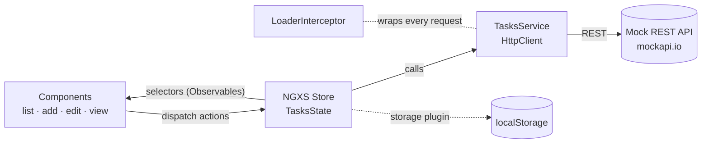
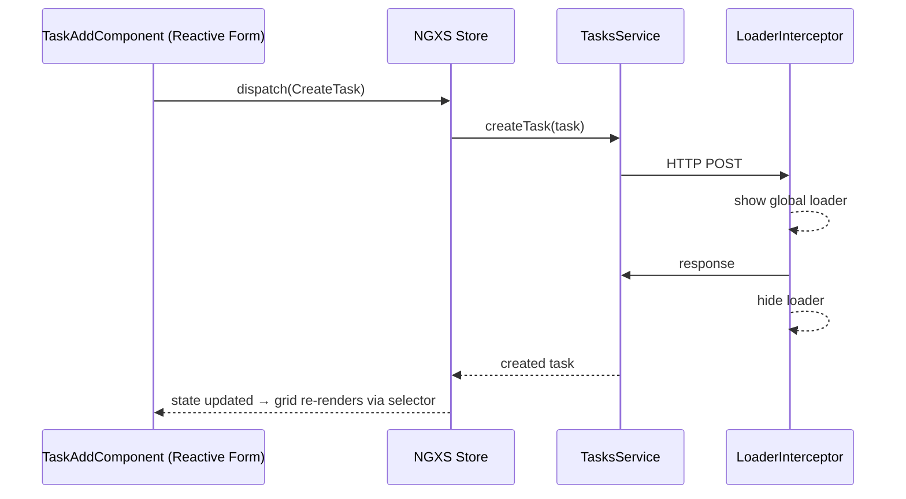

<div align="center">

# ✅ Task Management System

**A responsive, component-driven task manager built with Angular, Kendo UI, RxJS and NGXS — clean architecture, real-time search and reusable UI patterns.**

[](https://tms-flame.vercel.app/)


[Features](#-key-features--angular-concepts) · [Architecture](#%EF%B8%8F-architecture) · [Setup](#%EF%B8%8F-setup-instructions) · [Structure](#-project-structure) · [Lessons](#-lessons-learned)

</div>

---

## 📦 Tech Stack

- ⚙️ **Angular 18** — modular architecture with feature modules
- 🎨 **Kendo UI for Angular** — Grid, ListView, DropDowns, Inputs, Notifications, Loader
- ⚡ **RxJS** — async pipelines for search and HTTP
- 🧠 **NGXS** — centralized state (with storage, logger & devtools plugins)
- 🎯 **TypeScript** · 🧵 **SCSS**

## 💡 Key Features & Angular Concepts

| 🔑 Feature | 🧩 Implementation Detail |
|---|---|
| 🗂️ UI Grid / List | Kendo UI Grid & ListView – responsive, paginated task list |
| 🧱 Reusable UI Components | Kendo Grid, DropDown, Labels, Inputs, Card, DateRange, TextArea – wrapped as shared widgets |
| 🔍 Real-time Search | RxJS async pipelining + `async` pipe for optimized search |
| 🧪 Status-based Filtering | `TaskFilterPipe` – dynamically filters tasks by status |
| 🎨 Dynamic Styling | `StatusColorDirective` – applies conditional styling on the status field |
| 📝 Form Validation | Reactive Forms in `TaskAddComponent` & `TaskEditComponent` |
| ⏳ Global Loader | `LoaderInterceptor` – displays a loader on all HTTP requests |
| 🧭 Routing & Navigation | Angular Router: `/`, `/add`, `/view/:id`, `/edit/:id` |
| 🧠 State Management | NGXS – centralized state with selectors & actions, persisted via the storage plugin |
| 📱 Responsive Design | SCSS with Kendo UI – mobile-friendly, responsive layout |

## 🏗️ Architecture



<details>
<summary><b>🔁 What happens when you add a task</b></summary>

<br/>



</details>

## 🛠️ Setup Instructions

> Make sure you have the Angular CLI installed globally. If not, run `npm install -g @angular/cli`.

1. **Clone the repository**
   ```bash
   git clone https://github.com/Shariq2003/TMS.git
   cd TMS
   ```
2. **Install dependencies**
   ```bash
   npm install
   ```
3. **Start the development server**
   ```bash
   ng serve
   ```
4. **Visit the app** at `http://localhost:4200`

## 📁 Project Structure

<details>
<summary><b>Expand tree</b></summary>

```text
src/app/
├── interceptors/                 # LoaderInterceptor
├── shared/widgets/               # Kendo wrappers: button, card, daterange, dropdown,
│                                 # error, grid, input, label, loader, textarea
└── tasks/
    ├── components/               # task-list · task-add · task-edit · task-view
    ├── directives/               # StatusColorDirective
    ├── pipes/                    # TaskFilterPipe
    ├── services/                 # tasks · loader · notification
    └── store/                    # NGXS actions · models · states
```

</details>

## 🙌 Acknowledgements

- 👩‍💻 **Yashi** – for collaborating across modules and features
- 👨‍🏫 **Guddu Sir** – for mentoring and reviewing the project architecture
- 👩‍💼 **Vijeta Ma'am** – for project supervision and strategic feedback

## 📚 Lessons Learned

This project taught us how to:

- Design modular, maintainable Angular applications
- Use Kendo UI effectively with custom components
- Apply NGXS for clean and scalable state management
- Optimize user experience with loaders, interceptors, and dynamic filters

---

<div align="center">

Built with ❤️ by **[Shariq](https://github.com/Shariq2003)** and team · [LinkedIn](https://www.linkedin.com/in/shariq-sd)

⭐ If you like this project, consider giving it a star!

</div>
